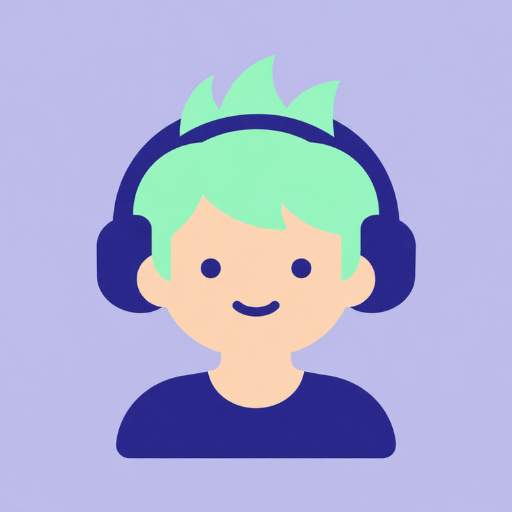
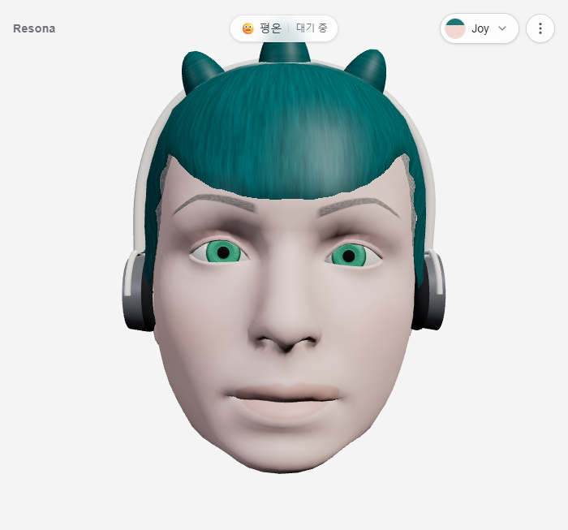
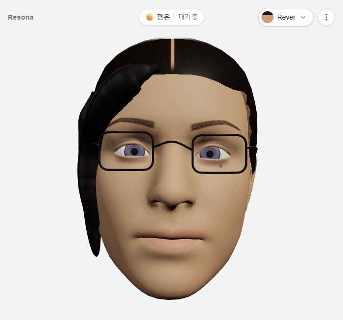
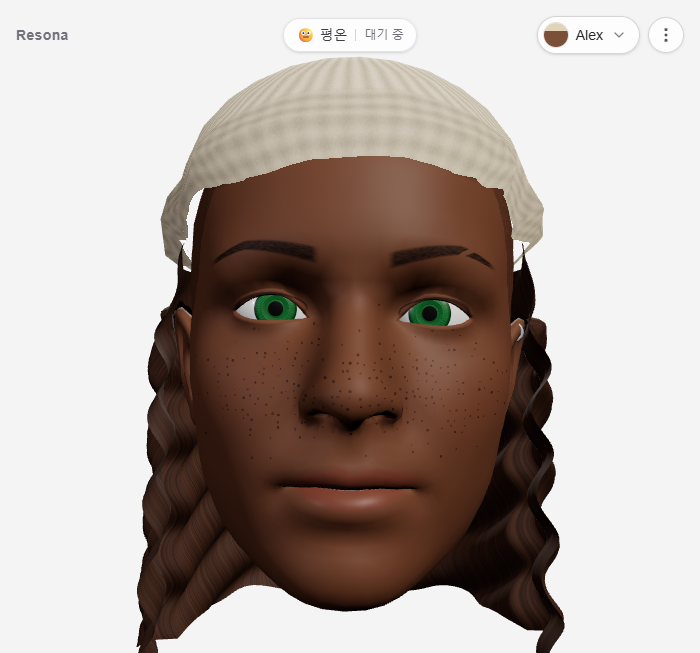
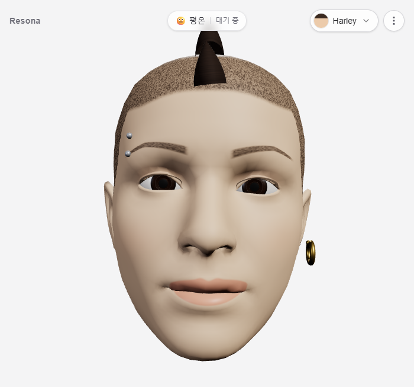
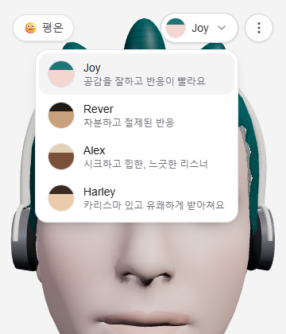

<a href="README.md">English</a> | <b>한국어</b>

  

<h1 align="center">Resona</h1>

  <b>내 말을 듣고, 듣는 사람처럼 반응하는 3D 캐릭터</b>

  <a href="https://hello-resona.vercel.app"><b>▶ 웹사이트</b></a> ·
  <a href="https://youtu.be/m4W5PU3zmM0"><b>소개 영상</b></a>

---

## 한눈에 보기

| | |
|---|---|
| **기간** | 2026.09.29 – 2026.10.21 (약 3주, 1인 개발) |
| **형태** | 개인 포트폴리오 프로젝트 · 기획 · 설계 · 개발 · 배포 전부 |
| **플랫폼** | 웹(PC·모바일) · Android 앱 · Chrome 확장 |
| **스택** | Next.js 16 · React 19 · TypeScript · three.js / React Three Fiber · Google Gemini (분석 + Live 음성) · Vercel |
| **소스 코드** | 비공개 저장소입니다. 요청하시면 리뷰용으로 열람 권한을 드립니다. |

## 무엇을 만들었나

대부분의 "감정 아바타"는 **문장의 감정**을 따라 합니다. "시험에 떨어졌어"라고 쓰면 아바타도 슬퍼지는 식입니다.
Resona는 **그 말을 들은 상대방의 반응**을 보여 줍니다. 같은 말이라도 듣는 사람은 걱정하거나, 위로하거나, 놀랄 수 있습니다.

캐릭터는 표정만 바꾸지 않고, 실제로 **듣고 있는 사람처럼** 움직입니다.

- 내가 말하는 동안에는 눈을 맞추고, 한쪽 귀를 기울이고, 말이 끊기는 순간에 끄덕입니다.
- 반응할 때는 표정과 고개 짓이 함께 들어오고(놀람은 고개를 뒤로, 슬픔은 시선을 떨굼), 몇 초 뒤 자연스럽게 가라앉습니다.
- 아무 말이 없으면 눈을 깜빡이고 주변을 둘러보다가, 오래 기다리면 심심한 표정을 짓습니다.

## 주요 기능

| 기능 | 설명 |
|---|---|
| **텍스트 · 음성 입력** | 입력창에 쓰거나 마이크로 말하면, 문맥을 읽고 가장 최근 말에 맞춰 표정이 바뀝니다. |
| **AI와 라이브 음성 채팅** | 앱 안에서 Gemini Live와 음성으로 대화합니다. 캐릭터는 옆에서 사용자 말과 AI의 답을 함께 듣고 반응합니다. AI가 답하는 도중에도 표정이 따라갑니다. |
| **ChatGPT와 함께 쓰기** | Chrome 확장이 chatgpt.com 대화를 브라우저 옆 패널의 Resona로 전달합니다. 사용자가 말하는 동안에는 표정을 유지하며 끄덕이고, ChatGPT가 답하면 반응합니다. *(이용약관 검토 전까지 개인·테스트용으로만 사용)* |
| **캐릭터 4종** | 생김새뿐 아니라 **성격**(표정의 크기, 반응 속도, 끄덕임·두리번거림 습관)이 다릅니다. |
| **Android 앱** | 배포된 웹을 Chrome으로 전체 화면 실행하는 TWA 앱. 웹을 배포하면 앱도 그대로 갱신됩니다. |
| **한국어 / English** | UI, 음성 인식 언어, 캐릭터 소개까지 전환됩니다. |

## 캐릭터

|  |  |  |  |
|:---:|:---:|:---:|:---:|
| **Joy** 공감을 잘하고 반응이 빨라요 | **Rever** 차분하고 절제된 반응 | **Alex** 시크하고 힙한, 느긋한 리스너 | **Harley** 카리스마 있고 유쾌하게 받아쳐요 |

네 캐릭터 모두 **3D 얼굴 모델 파일 하나**(ARKit 52 blendshape)로 만들었습니다. 눈썹·입술·점·주근깨는 셰이더로 그리고, 앞머리·모호크·긴 곱슬머리·헤드셋·안경은 코드로 생성해 머리 표면에 맞춰 붙였습니다. 외부 3D 아바타 서비스(Ready Player Me)가 종료되면서, 외부 의존 없이 직접 만드는 쪽을 택했습니다.

## 기술적으로 고민한 것

**1. "듣는 사람의 반응"을 구조화된 값으로**
Gemini에 JSON schema를 지정해 7가지 감정(기쁨·슬픔·화남·놀람·걱정·혼란·실망)의 강도 벡터만 받습니다. 이 벡터를 캐릭터 성격(감정별 가중치, 반응 임계값)으로 한 번 거른 뒤 ARKit blendshape 조합으로 바꿉니다.

**2. 실시간성과 비용 사이의 요청 정책**
- 타이핑·음성 입력: 400ms 디바운스 + 새 입력이 오면 진행 중인 요청 취소(가장 최신 문맥만 반영).
- 스트리밍 대화(AI 답변): 위 방식은 답이 끝날 때까지 표정이 멈추는 문제가 있어서, 요청을 하나만 유지하고 끝나면 가장 최신 문맥을 이어 보내는 방식으로 바꿨습니다.
- 사용자가 말하는 중에는 분석하지 않고 듣는 동작만 합니다. 불필요한 호출과 어색한 표정 변화를 함께 줄였습니다.

**3. 살아 있는 것처럼 보이는 행동 엔진 (PresenceEngine)**
상태(Idle / Listening / Reacting)가 움직임의 빈도와 크기만 바꾸고, 표정·깜빡임·시선·끄덕임·미세 움직임 레이어는 항상 돌아갑니다. 간격은 log-normal 분포, 머리 움직임은 주기 없는 노이즈, 전환은 spring으로 처리해 반복 패턴이 보이지 않게 했습니다.

**4. 무료로, 막히지 않게**
- Gemini 무료 등급만 사용합니다. 여러 모델을 순서대로 시도하고, 모델별로 한도 대기 시간을 따로 관리합니다. 모두 실패하면 키워드 분석으로 넘어가 캐릭터는 계속 반응합니다.
- 기기·계정·IP·전체 단위의 호출 한도를 두고, 사용자가 원하면 본인 Gemini 키를 연결해 한도를 늘릴 수 있습니다.
- 대화를 외부로 보내기 전에 명시적으로 동의를 받습니다(opt-in). 동의하지 않으면 기기 안에서만 분석합니다.

**5. 결제 없이 비싼 기능 열기**
개인 개발자라 결제를 붙이기 어려워, 라이브 채팅은 **파트너 코드**로 엽니다. 앱에서 신청하면 운영자에게 서명된 승인 링크가 메일로 오고, 승인하면 신청자에게 코드가 자동 발송됩니다. 서버에 저장하는 상태는 없습니다.

**6. 구조**
Model(`lib`, 서버 전용은 `lib/server`) · ViewModel(커스텀 훅) · View(컴포넌트)로 나눴습니다. 대화 입력원(Gemini Live WebSocket, OpenAI Realtime WebRTC, Chrome 확장 postMessage)은 하나의 `ConversationSource` 인터페이스로 묶어, 캐릭터 쪽은 입력원이 무엇이든 같은 방식으로 반응합니다.

## 이용해 보기

- **웹:** https://hello-resona.vercel.app — PC 또는 모바일 Chrome 권장 (마이크 사용 시 권한 허용)
- **AI 라이브 채팅:** 앱에서 "AI와 라이브 채팅" → 이용 신청을 하시면 파트너 코드를 메일로 보내 드립니다.
- **Android 앱 · 소스 코드 열람:** 필요하시면 연락 주세요.

## 연락

Yeji Yeo · yejiyeo@gmail.com
